# TabDepot help

*Store tabs. Clear space. Find them anytime.*

TabDepot moves your open tabs into a stash page. Stashed tabs are closed, so they use no memory, but each one stays on the page as a card with a picture, a title and a description that you can search, group and reopen whenever you like. This guide explains everything you can click or press.

The pictures use made-up sample data. You can regenerate them with `node tests/screenshots.mjs`.

**Contents**
1. [The basics](#the-basics)
2. [The toolbar popup](#the-toolbar-popup)
3. [The top bar](#the-top-bar)
4. [Filters and selecting](#filters-and-selecting)
5. [Groups and the sidebar](#groups-and-the-sidebar)
6. [Cards](#cards)
7. [Working on several cards at once](#working-on-several-cards-at-once)
8. [The ⋯ menu](#the--menu)
9. [Dialogs](#dialogs)
10. [Keyboard shortcuts](#keyboard-shortcuts)
11. [Triage mode](#triage-mode)
12. [Settings](#settings)
13. [Outside the stash page](#outside-the-stash-page)
14. [Where your data is](#where-your-data-is)

---

## The basics

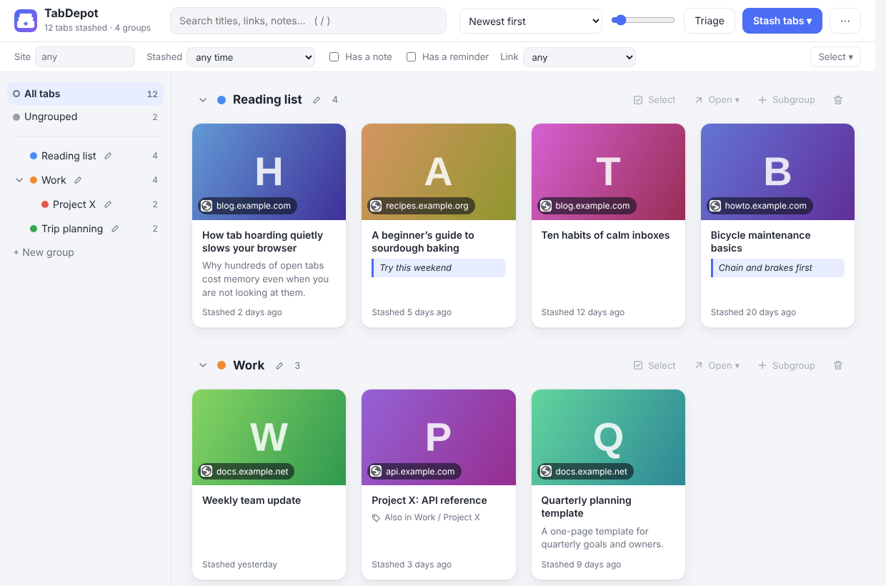

- **Stash** tabs with the toolbar button, a keyboard shortcut or the right-click menu. They close, and appear as cards.
- **Find** them with the search box, the sidebar groups and the filters.
- **Open** a card to bring the tab back. By default it is also removed from the stash; you can change that in [Settings](#settings).
- **Undo** (Ctrl+Z, or the *Undo* link that appears after a change) reverses the last change. Only that change is undone, never anything you did later.

---

## The toolbar popup

Click the TabDepot icon in the browser toolbar. The number on the icon is how many tabs are in your stash.

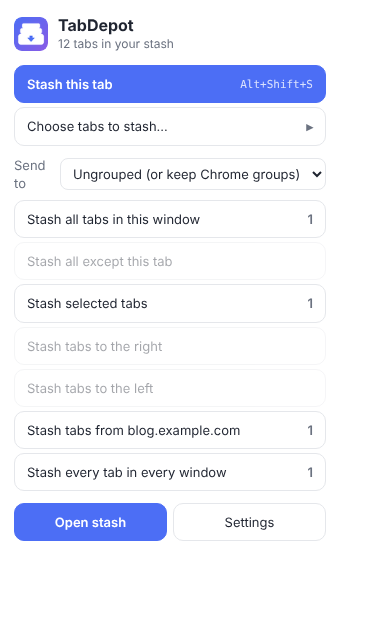

| Button | What it does |
|---|---|
| **Stash this tab** (Alt+Shift+S) | Stashes the tab you are looking at. |
| **Choose tabs to stash…** | Shows all your open tabs with check boxes so you can pick which ones to stash. |
| **Send to** | Which group the stashed tabs go to: *Ungrouped (or keep Chrome groups)*, an existing group, or a new group you name. |
| **Stash all tabs in this window** | Everything in this window (pinned tabs stay unless *Include pinned tabs* is on in Settings). |
| **Stash all except this tab** | Everything in this window except the one you are on. |
| **Stash selected tabs** | Only the tabs you have highlighted (Ctrl- or Shift-click on tabs). Shown only when several tabs are highlighted. |
| **Stash tabs to the right / to the left** | Tabs after or before the current one in this window. |
| **Stash tabs from this site** | Every open tab from the same website as the current one, in all windows. |
| **Stash every tab in every window** | All windows. |
| **Open stash** | Opens the stash page. |
| **Settings** | Opens the stash page's settings. |

Each button shows how many tabs it will stash. Buttons that would stash nothing are greyed out. If a stash would close every tab in the window, TabDepot opens the stash page in that window so the window stays open.

---

## The top bar

- **Search** (press `/`): finds cards by title, link, description, note or group name. Every word you type must match.
- **Sort**: *Newest first*, *Oldest first*, *Title A–Z*, *Site A–Z*, or *Manual (drag to reorder)*. With Manual you drag cards into your own order.
- **Slider**: card size. Both Sort and the slider are remembered.
- **Triage**: goes through the tabs one at a time (see [Triage mode](#triage-mode)).
- **Stash tabs ▾**: *Choose tabs to stash…* (the picker below), *Stash all tabs in this window*, *Stash every tab in every window*.
- **⋯**: the [tools menu](#the--menu).

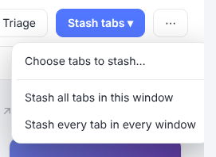

The picker lists every open tab, by window. You can filter by typing, use *All* / *None*, choose a group in *Send to*, and press the button at the bottom to stash. Tags on a tab tell you if it is *pinned*, *♪ playing*, *asleep* (not loaded) or *already stashed*.

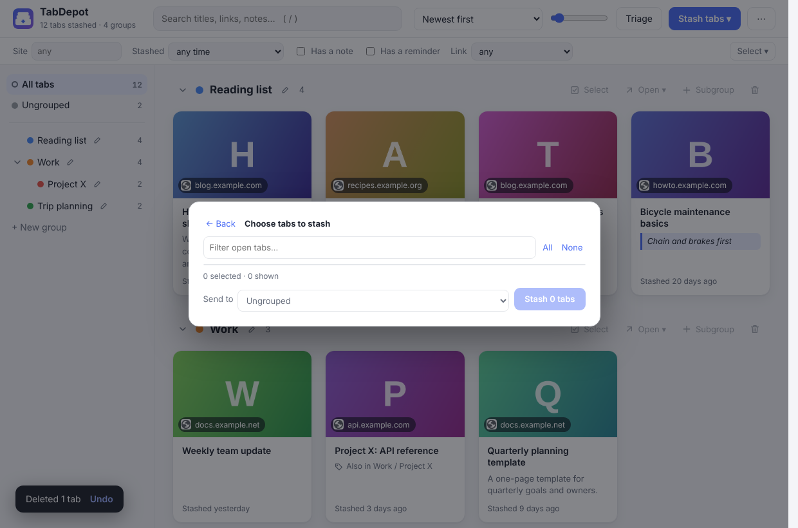

Search results are shown across all groups:

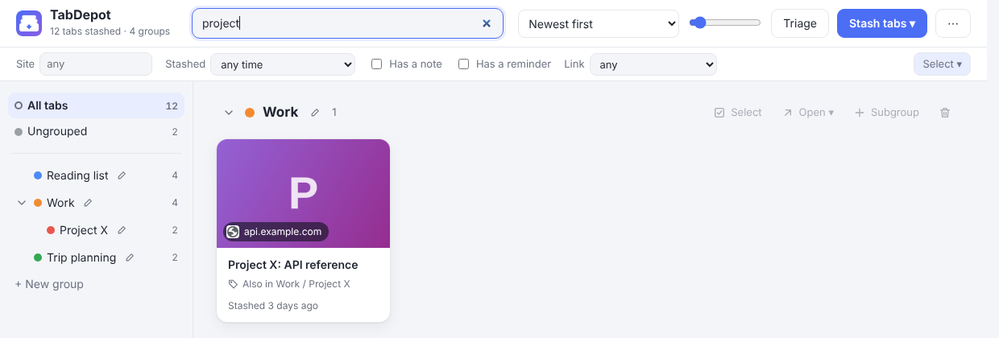

---

## Filters and selecting

The row under the top bar narrows what is shown. Filters combine with the search box.

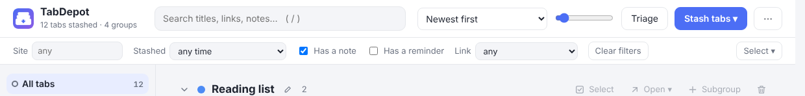

| Filter | Shows |
|---|---|
| **Site** | Cards whose website contains what you type. Suggestions list the sites you have most of. |
| **Stashed** | Only tabs stashed more than a week, 30 days, 90 days or a year ago. Good for cleaning out old tabs. |
| **Has a note** | Cards that have a note. |
| **Has a reminder** | Cards with a reminder set. |
| **Link** | Results of *Check links*: *dead / unreachable*, *dead* (page gone, 404 or 410, or a removed video), *restricted* (exists but needs a login or is blocked), *unreachable* (server error, timeout, no connection), *working*, or *not checked*. |
| **Clear filters** | Appears when a filter is on. |

**Select ▾** (right end of the row):

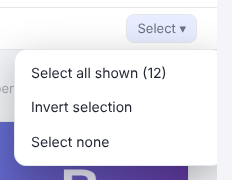

- *Select all shown* selects the cards in the current view. *Select all N matching* selects every card in the whole stash that matches the search and filters, whichever group you are looking at. *Invert selection* swaps selected and unselected. *Select none* clears.

---

## Groups and the sidebar

The sidebar lists **All tabs**, **Ungrouped** and your groups, each with a count. Click one to show only that group. A tab can be in **several groups** at once, and groups can contain **subgroups**.

- **Arrow** before a group: show or hide its subgroups in the sidebar.
- **Pencil**: rename, recolour or move the group (choose another group under *Inside*).
- **+ New group** at the bottom (or **+ New subgroup here** when a group is selected).
- **Drag a group** up or down to reorder, onto another group to nest it, or onto the box *Drop a group here to make it top-level*.
- **Drag cards** onto a group to **move** them there. Hold **Ctrl** or **Alt** while dropping to **add** them to that group as well and leave them where they are.

**Right-click a group:**

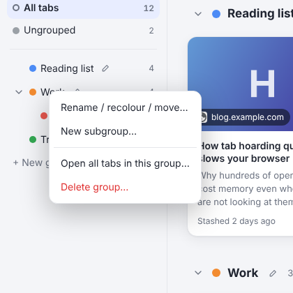

- *Rename / recolour / move…*, *New subgroup…*, *Open all tabs in this group…* (opens the Open menu below) and *Delete group…*.

**What “Delete group” deletes.** Only the group itself. Its tabs are **not** deleted: they stay in the stash and in any other groups they belong to, and tabs that were only in that group become *Ungrouped*. Its subgroups move up one level. You are asked to confirm, a safety snapshot is taken first, and *Undo* brings the group back exactly as it was.

**On the main page** each group is a section:

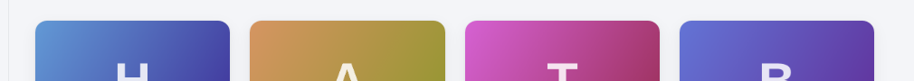

- **Chevron or name**: collapse or expand the section (remembered).
- **Select**: select or unselect every card in the section.
- **Open ▾**: open every card in the section (see [the Open menu](#working-on-several-cards-at-once)).
- **Subgroup**: add a subgroup here. The bin button deletes the group (see above).
- On the *Ungrouped* section, **Group by site** creates a group for every website that has two or more tabs.

---

## Cards

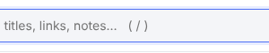

Each card shows the picture, the site, the title, the description, your note, a *Also in…* line if the tab is in other groups, a reminder line if there is one, and when it was stashed. A **Dead link** / **Restricted** / **Unreachable** badge appears after you check links.

**Clicking**
- **Click** opens the tab (and removes it or keeps it, as set in Settings). **Alt-click** does the opposite. **Middle-click** opens it in the background.
- **Check box** (top left): select. **Shift-click** a second check box to select the whole range.
- Hover buttons, left to right: *Open and remove*, *Open and keep*, *More*, *Delete*.
- **Drag** a card to another group in the sidebar, or (with *Manual* sort) to a new place on the page.

**Right-click a card, or press More**

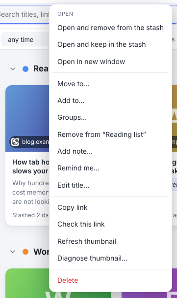

| Item | What it does |
|---|---|
| **Open and remove from the stash** / **Open and keep in the stash** | Opens the tab and removes the card, or keeps it. |
| **Open in new window** | Opens it in a window of its own. |
| **Move to…** | Moves it to one group; it leaves its other groups. |
| **Add to…** | Adds it to another group and keeps its current groups. |
| **Groups…** | A list of every group with check boxes, to put the card in any number of groups. |
| **Remove from “group”** | Takes the card out of the group you are viewing (it is not deleted). |
| **Add note… / Edit note…** | A note for yourself: why you kept it, what to do with it. Notes are searchable. |
| **Remind me… / Change reminder…** | See [Reminders](#reminders). |
| **Edit title…** | Change the title shown on the card. |
| **Copy link** | Copies the web address. |
| **Check this link** | Tests whether the page still exists, without opening it. |
| **Refresh thumbnail** | Fetches the picture again. |
| **Diagnose thumbnail…** | Explains why a card has no good picture (useful for reporting problems). |
| **Delete** | Removes the card. *Undo* brings it back (and, if switched on, [Recently deleted](#recently-deleted)). |

If you right-click one of several selected cards, Move to, Add to, Groups and Remind apply to **all selected**.

---

## Working on several cards at once

Tick cards (or use **Select ▾**) and a bar appears:

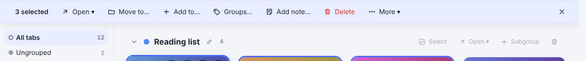

| Button | What it does |
|---|---|
| **Open ▾** | Opens the selected cards, see below. |
| **Move to… / Add to…** | As on a card, for all selected. |
| **Groups…** | Check boxes show which groups all, some or none of the selected cards are in. |
| **Add note…** | Adds a note to all selected cards (you can add to existing notes or replace them). |
| **Delete** | Deletes them. A safety snapshot is taken first when you delete 5 or more. |
| **×** (or Esc) | Clears the selection. |

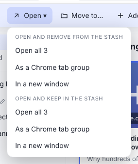

The **Open** menu (also on each group's **Open ▾** button) has two halves: *Open and remove from the stash* and *Open and keep in the stash*. In each: **Open all N** (the way set in Settings under *When I open several tabs at once*), **As a Chrome tab group** (named and coloured like your group), and **In a new window**. If you set several tabs to open as a group or window by default, an **As plain tabs in this window** choice appears too. Opening more than 25 tabs asks you to confirm.

**More ▾**

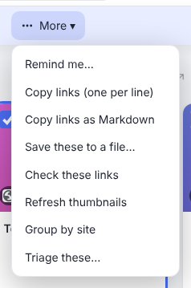

- *Remind me…* (one reminder for all selected), *Copy links (one per line)*, *Copy links as Markdown*, *Save these to a file…* (a backup of just these cards, with pictures), *Check these links*, *Refresh thumbnails*, *Group by site* (groups the selected cards by website), *Triage these…*.

---

## The ⋯ menu

The tools menu, in groups. **Import and export** is one section that starts folded; click its heading to unfold it (it stays as you leave it while the page is open).

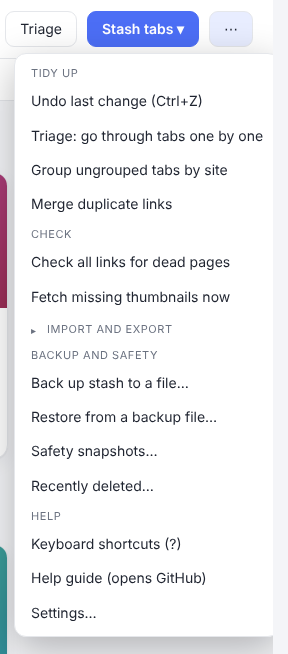

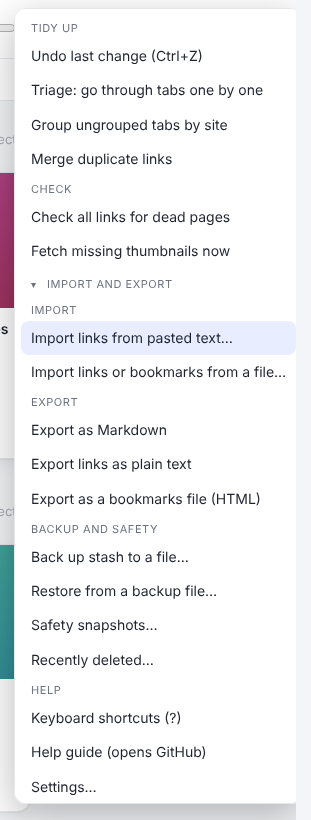

**Tidy up**
- **Undo last change (Ctrl+Z).** Reverses the last change. Up to 60 steps are remembered while the page is open.
- **Triage: go through tabs one by one.** See [Triage mode](#triage-mode).
- **Group ungrouped tabs by site.** Makes a group for each website that has two or more ungrouped tabs (or, if cards are selected, from the selection).
- **Merge duplicate links.** Combines cards that point to the same page (links that differ only by tracking codes, a trailing slash or a `#` part count as the same; every kind of link to the same YouTube video counts as one). The newest card is kept and the groups and notes are combined.

**Check**
- **Check all links for dead pages** (or *Check links of selected tabs* when some are selected). Asks each website whether the page still exists, without opening it. Progress shows at the top with a *Stop* button. Results appear as badges and in the **Link** filter.
- **Fetch missing thumbnails now.** Looks for pictures for cards that have none.

**Import and export** (click the heading to fold or unfold)
- **Import links from pasted text…** See [Import links from text](#import-links-from-text).
- **Import links or bookmarks from a file…** Reads a TabDepot backup (`.json`), a text file of links (`.txt`), or a browser bookmarks file (`.html`, from Chrome, Edge, Firefox or Safari: folders become groups). Links you already have are not added again; their groups are merged. A safety snapshot is taken first.

- **Export as Markdown.** A `.md` file with a heading per group and a link per card, with notes.
- **Export links as plain text.** A `.txt` file with one web address per line.
- **Export as a bookmarks file (HTML).** Any browser can import it; groups become folders.

**Backup and safety**
- **Back up stash to a file…** A full backup (`.json`) with pictures. Keep it somewhere safe.
- **Restore from a backup file…** Adds what is missing from a backup. It never deletes anything you have now.
- **Safety snapshots…** See [Safety snapshots](#safety-snapshots).
- **Recently deleted…** See [Recently deleted](#recently-deleted).

**Help**
- **Keyboard shortcuts (?)**, **Help guide (opens GitHub)** (this page), **Settings…**.

---

## Dialogs

### Reminders

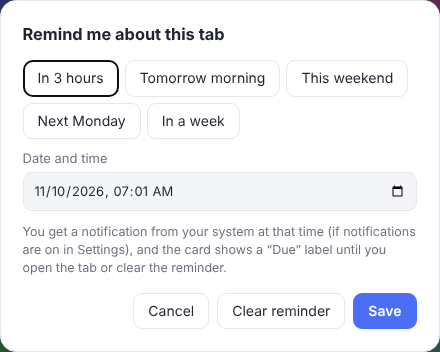

*Remind me…* (card menu, selection bar, or press `r`) takes a date and time, with quick choices (in 3 hours, tomorrow morning, this weekend, next Monday, in a week). At that time you get a notification from your system with **Open the tab** and **Remind me in 1 hour** buttons (clicking the notification opens the stash). The card then shows **Due** in red until you open the tab, change the reminder or clear it. *Clear reminder* removes it. The **Has a reminder** filter lists them. If notifications are off in Settings, you still see the Due label. A reminder that came due while the browser was closed is announced when it starts.

### Import links from text

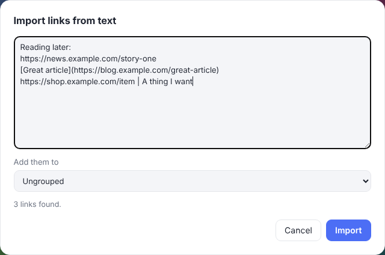

Paste anything that contains web addresses: a plain list, an email, Markdown, a OneTab export (`https://example.com | Title`) or the HTML of a page. TabDepot finds every link, keeps titles when the text has them, ignores duplicates, and tells you how many it found. Choose **Add them to** a group, or *Ungrouped*, then **Import**.

### Edit a group, edit a tab

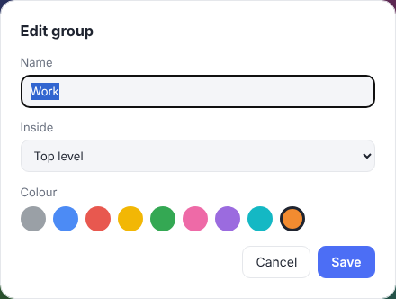

The group dialog sets the **name**, which group it is **inside** (for subgroups) and its **colour**. The tab dialog changes a card's title and note:

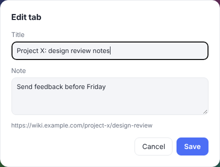

### Recently deleted

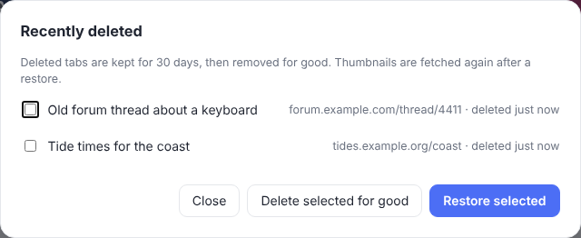

Off by default; turn it on in Settings. When on, tabs you delete are kept for 30 days. Tick the ones you want and choose **Restore selected** (with nothing ticked, everything is restored) or **Delete selected for good**. Tabs you opened and removed from the stash are not kept here, and pictures are fetched again after a restore.

### Safety snapshots

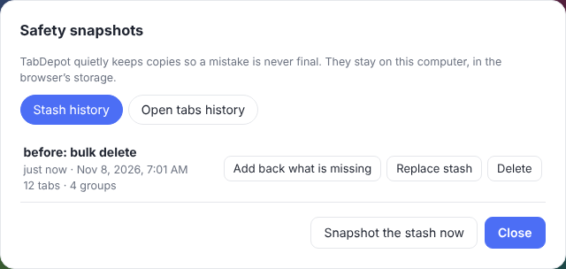

TabDepot quietly keeps copies so a mistake is never final. There are two lists:

- **Stash** snapshots: a copy of your cards and groups. *Add back what is missing* keeps your current stash and adds whatever the snapshot has that you do not. *Replace stash* makes the stash exactly like the snapshot (your current state is saved first).
- **Open tabs** snapshots: the tabs you had open, including windows you closed. *View tabs…* lets you open some of them or add them to the stash.

*Snapshot the stash now* and *Snapshot open tabs now* take one by hand. See [Settings](#settings) for how often they happen.

---

## Keyboard shortcuts

Press **?** on the stash page to see this list.

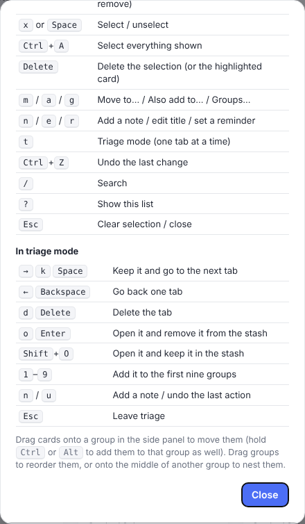

On the stash page: arrows move between cards; **Enter** opens (Shift+Enter does the opposite of your setting); **x** or **Space** selects; **Ctrl+A** selects everything shown; **Delete** deletes; **m**, **a**, **g** are Move to, Add to, Groups; **n** adds a note; **e** edits the title; **r** sets a reminder; **t** starts triage; **Ctrl+Z** undoes; **/** searches; **?** shows the list; **Esc** clears the selection or closes.

---

## Triage mode

Press `t`, click **Triage**, or choose *Triage these…* on a selection. TabDepot shows your tabs one at a time, large, and you decide with a key. It goes through the selected cards, or everything currently shown (so search and filters narrow it down).

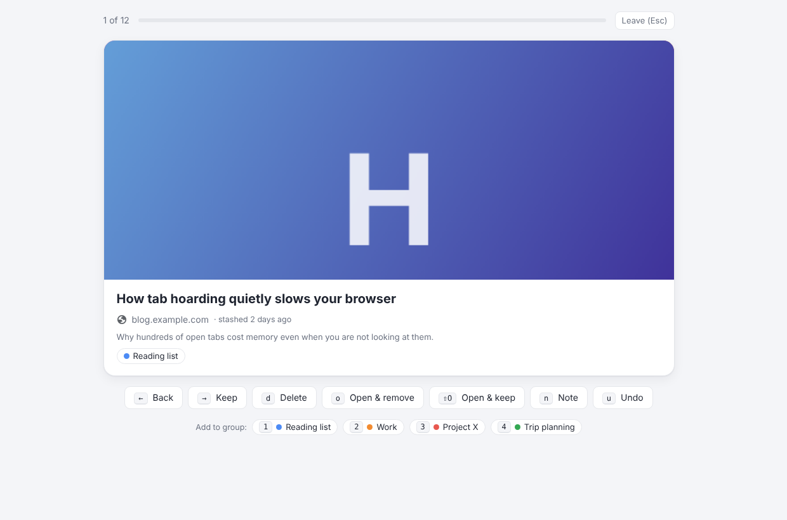

| Key | Does |
|---|---|
| **→**, **k**, **Space** | Keep it and go to the next. |
| **←**, **Backspace** | Go back one. |
| **d**, **Delete** | Delete it. |
| **o**, **Enter** | Open it and remove it from the stash. |
| **Shift+O** | Open it and keep it in the stash. |
| **1**–**9** | Add it to one of the first nine groups (shown at the bottom). |
| **n** | Add a note. |
| **u** | Undo the last action. |
| **Esc** | Leave triage. |

When you reach the end you get a summary of how many you kept, deleted, opened and grouped.

---

## Settings

Open it from the ⋯ menu, from the popup, or with the *Settings* button. The options are in sections you can open and close.

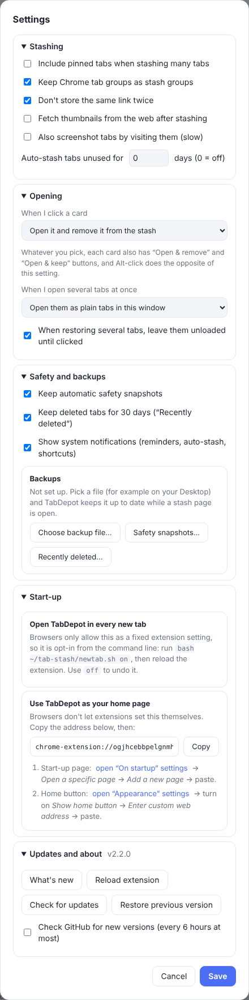

#### Stashing
- **Include pinned tabs when stashing many tabs.** Off by default, so “stash all tabs in this window” leaves your pinned tabs alone. Stashing one pinned tab on purpose always works.
- **Keep Chrome tab groups as stash groups.** When you stash tabs that sit in a Chrome tab group, a stash group with the same name and colour is created (or reused) for them.
- **Don't store the same link twice.** A link that is already stashed is not added again; the existing card is kept. Links that differ only by tracking parameters or a trailing slash count as the same.
- **Fetch thumbnails from the web after stashing.** The thumbnail is fetched from the page's preview image (or YouTube's thumbnail) without opening or touching any tab. Turn it off to stash faster and use less network.
- **Also screenshot tabs by visiting them (slow).** Off by default. TabDepot normally uses the screenshot it already took while you were looking at a tab. With this on, it briefly visits tabs it has no picture of. That is slow and can start a video playing.
- **Auto-stash tabs unused for N days.** Every 30 minutes, tabs you have not looked at for N days (not pinned, not playing sound, not the active tab) are stashed. 0 turns it off.

#### Opening
- **When I click a card.** *Open it and remove it from the stash* (default), *Open it and keep it in the stash*, or *Ask me each time*. Every card also has both buttons, and Alt-click does the opposite of this setting.
- **When I open several tabs at once.** Used by “Open all”, the selection bar and group menus: as plain tabs in this window (default), as a Chrome tab group named after the stash group, or in a new window. The Open menu can still pick a different way for one action. One card always opens as a plain tab.
- **When restoring several tabs, leave them unloaded until clicked.** Only the first tab loads; the others wait until you click them, so opening a big group does not slow the browser down.

#### Safety and backups
- **Keep automatic safety snapshots.** A copy of your stash is saved every 30 minutes (only if something changed) and before risky actions such as bulk delete or import. A list of your open windows is saved every 10 minutes (only if it changed) and whenever you close a window. The last 40 stash snapshots and 30 window snapshots are kept, on this computer only. Open them with **Safety snapshots…**.
- **Keep deleted tabs for 30 days (“Recently deleted”).** Off by default. When on, a tab you delete can be restored from **Recently deleted…** for 30 days. Tabs you open and remove from the stash do not go there. Thumbnails are fetched again after a restore.
- **Show system notifications.** Reminders, auto-stash, and stashes made with a shortcut or the right-click menu show a notification from your operating system. Switching this off also silences reminders (the card still shows “Due”).
- **Backups.** *Choose backup file…* picks a file (for example on your Desktop) that TabDepot keeps up to date a minute and a half after each change while a stash page is open. Pointing it at a folder that your sync app (Dropbox, Syncthing and so on) watches is an easy way to keep a copy on another computer. Thumbnails are not included; they are fetched again.

#### Start-up
- **Open TabDepot in every new tab.** Browsers only allow this as a fixed extension setting, so it is a command: `bash ~/tab-stash/newtab.sh on` (and `off`), then reload the extension. Use your own folder name in the path.
- **Use TabDepot as your home page.** Browsers do not let extensions set this. The dialog gives you the address and links to the browser pages where you paste it.

#### Updates and about
- **What's new, Reload extension, Check for updates, Restore previous version.** *Reload extension* is for after you replace the files by hand. *Restore previous version* puts back the files saved before the last in-app update.
- **Check GitHub for new versions.** At most every 6 hours, and it only asks GitHub for the number of the latest release. Switch it off if you never want TabDepot to contact GitHub (you can still use *Check for updates* yourself).

---

## Outside the stash page

- **Keyboard shortcuts in the browser:** **Alt+Shift+S** stashes the current tab, **Alt+Shift+O** opens TabDepot. “Stash all tabs in this window” has no key until you give it one (Chrome: `chrome://extensions/shortcuts`).
- **Right-click menus:** on a page, *Stash this tab*. On a link, *Stash this link*. On the toolbar icon, *Open TabDepot*.
- **System notifications** for reminders, auto-stash and stashes made with a shortcut or menu (switch off in Settings).
- **More than one stash page open:** a notice says so and the pages stay in sync.
- **After an update:** a stash page that was already open shows a banner offering *Reload this page*, so you do not keep running old code.

---

## Where your data is

Everything stays in your browser on your computer: cards, groups, notes, reminders, pictures and snapshots. TabDepot has no account and sends nothing anywhere. It makes web requests only to fetch thumbnails and descriptions for pages you stashed, to check links when you ask, and (unless you turn it off) to ask GitHub for the number of the newest version. See the [README](../README.md) for installing and updating.
